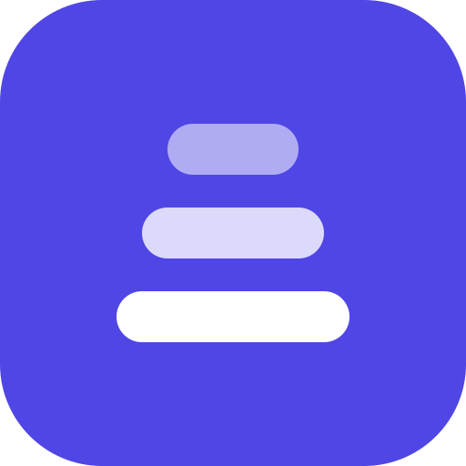
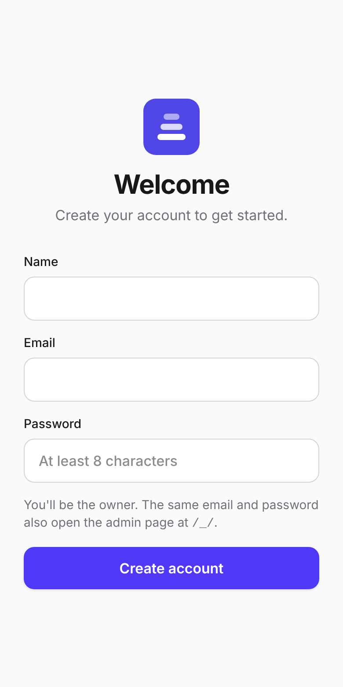
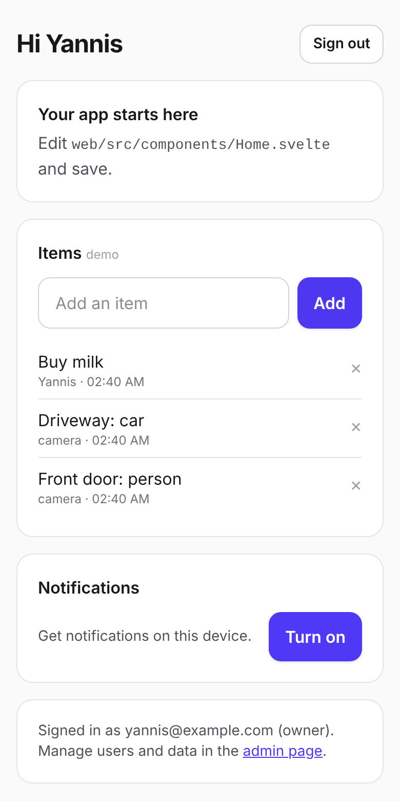
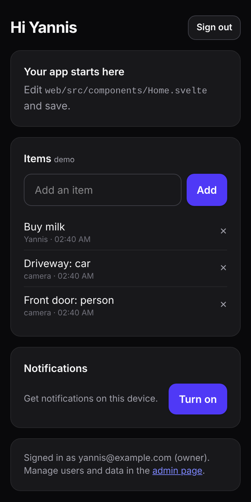
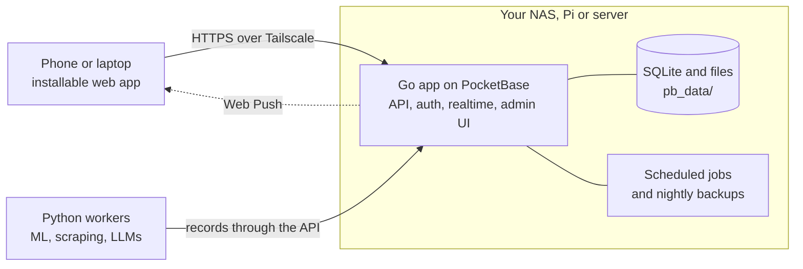

<div align="center">



# plasto

**A template for self-hosted apps: from an idea to an app on your phone,<br>
running in one small container on your own hardware.**

[](https://github.com/kalfasyan/plasto/actions/workflows/ci.yml)
[](LICENSE)
[](backend/go.mod)
[](https://pocketbase.io)
[](https://svelte.dev)
[](https://tailwindcss.com)
[](workers/README.md)
[](https://github.com/kalfasyan?tab=packages&repo_name=plasto)

[](https://github.com/kalfasyan/plasto/generate)
[](https://buymeacoffee.com/kalfasyan)

&nbsp;
&nbsp;


</div>

plasto gives every new app the parts that keep getting rebuilt: sign-in and roles,
a database with an admin UI, push notifications, scheduled jobs, backups, Python
workers and a one-command deploy. You add your own idea on top.

It is built on [PocketBase](https://pocketbase.io) (Go, SQLite, auth, realtime,
admin UI) and [Svelte 5](https://svelte.dev) with
[Tailwind](https://tailwindcss.com). See [docs/decisions.md](docs/decisions.md)
for why.

<!-- TEMPLATE start (rename.sh removes this section from new apps) -->
## Start a new app

1. On GitHub, click **Use this template** and create your app's repository.
2. Clone it and run `scripts/rename.sh`: plasto becomes your repository's name in
   the code, images, env vars and docs.
3. Run `scripts/strip-demo.sh` to remove the demo, or keep it as a reference for now.
4. Follow [Build your first feature](docs/first-feature.md).

<!-- TEMPLATE end -->

## Quick start

You need [Go](https://go.dev/dl/) 1.27+, [Node](https://nodejs.org) 22+ and
[uv](https://docs.astral.sh/uv/) (for the Python workers).

```sh
make setup   # install dependencies
make dev     # backend on :8090, web app with live reload on http://localhost:5173
```

Open the app and create your account: the first person becomes the **owner**
and can also sign in to the admin UI at http://localhost:8090/_/ with the same
email and password. Add more people there, in the `users` collection.

## What you get

- **First-run setup and sign-in.** No terminal needed to create the first account.
- **Users and roles.** The owner manages everyone; members can see each other and
  edit themselves. Nobody can sign themselves up.
- **Push notifications** straight from your server, with no account or third-party
  service. Each person turns them on per device; send one from Go with
  `push.ToUser(app, userID, push.Message{Title: "…", URL: "/…"})`. Phones need the
  app on HTTPS.
- **Scheduled jobs that don't get skipped.** `jobs.MustAdd(app, "digest", "0 7 * * *", fn)`
  runs on a cron schedule in your time zone (`TZ`). If the server was off when a job
  was due, it runs once when the server starts again. Every run and its error are
  listed in the admin UI under the `jobs` collection.
- **Nightly backups** of the database and uploads at 03:00, keeping the last 7, in
  `pb_data/backups`. Change the schedule or add S3 storage in the admin UI under
  Settings > Backups.
- **Python workers** for the heavy lifting (ML, scraping, LLMs), on this machine or
  another. They sign in with a worker account and read and write records through
  the API; see [workers/README.md](workers/README.md).
<!-- DEMO start -->
- **A demo** that uses every piece: a live items list on the home screen, a worker
  that adds to it, and a push notification for each new item.
  `scripts/strip-demo.sh` removes it.
<!-- DEMO end -->
- **An installable app.** It installs to a phone's home screen or a desktop, opens
  offline from its cached shell, and follows the system's light or dark mode.

## How it fits together



Everything a person sees is the web app, served by the Go app. Heavy work runs in
Python workers, here or on another machine, which write records; Go hooks react to
those records and notify people.

## Deploy

On any Linux machine with Docker (a NAS, a Raspberry Pi, a server):

```sh
curl -fsSL https://raw.githubusercontent.com/kalfasyan/plasto/main/deploy/install.sh | sh
```

It asks for a Tailscale auth key, so your devices reach the app at
`https://plasto.<your-tailnet>.ts.net`, and starts it with Docker Compose. See
[docs/deploy.md](docs/deploy.md) for updates, backups, workers, Synology and the Pi.

## Layout

```
backend/            Go app on PocketBase
  main.go           entry point
  app/              routes, hooks and jobs (start here)
  jobs/             scheduled jobs with catch-up
  push/             Web Push: keys, subscriptions, sending
  migrations/       database schema as code
web/                Svelte 5 + Tailwind web app
  src/App.svelte    picks setup, sign-in or the app
  src/components/   screens; Home.svelte is where your app starts
  src/lib/          shared code (API client, session, install) and its tests
  public/           manifest, service worker and icons
workers/            Python worker kit, your workers, their tests and image
deploy/             compose files, Tailscale sidecar, install script, smoke test
docs/               decisions, the deploy guide and the first-feature guide
Dockerfile          the app's multi-arch image
Makefile            run `make` to see every command
```

## Commands

| Command      | What it does                                          |
| ------------ | ----------------------------------------------------- |
| `make dev`   | Run everything with live reload                       |
| `make check` | Format, lint and type-check                           |
| `make test`  | Run the Go, web and worker tests                      |
| `make build` | Build `dist/plasto` with the web app next to it       |
| `make run`   | Build the Docker image and run it on :8090            |
| `make smoke` | Deploy both images with Compose and test end to end   |

Pushes to `main` publish `ghcr.io/kalfasyan/plasto` and
`ghcr.io/kalfasyan/plasto-worker` for amd64, arm64 and armv7; a `v*` tag
publishes that version.

## Support

If plasto saves you time, you can [buy me a coffee](https://buymeacoffee.com/kalfasyan).

## License

MIT
