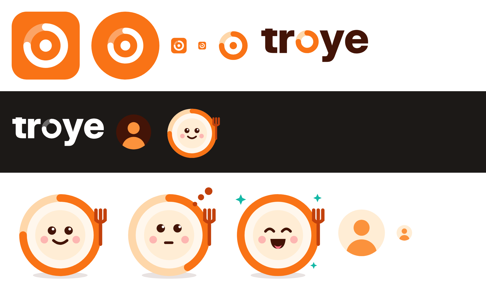

# Troye brand

Troye's look is built around one idea: **the plate is the calorie ring**. A plate seen from
above is a circle, and the day's calorie budget is a ring that fills up as you log food. The
logo, the "o" in the wordmark and the mascot all use that ring, so the brand and the app's
main screen speak the same language.

## Assets

All files are SVG in `web/public/brand/` unless noted, so the web app serves them at `/brand/...`.

| File | Use |
| --- | --- |
| `web/public/icons/icon.svg` | App icon: favicon, sign-in header, anywhere a square logo fits |
| `web/public/icons/*.png` | PWA and home-screen icons, rendered from the SVGs |
| `icon-maskable.svg` | Full-bleed icon source for `icon-maskable-512.png` and `apple-touch-icon.png` |
| `mark.svg` | The ring alone, on transparent, for next to text or as a loading spinner |
| `wordmark.svg` | "troye" on light backgrounds |
| `wordmark-white.svg` | "troye" on dark or orange backgrounds |
| `plato.svg` | Mascot, default (happy) |
| `plato-thinking.svg` | Mascot while waiting for an answer or analysing a photo |
| `plato-cheer.svg` | Mascot for goals reached, streaks, onboarding done |
| `avatar-default.svg` | User avatar before they add a photo (light theme) |
| `avatar-default-dark.svg` | Same, for dark theme |

The wordmark letters are outlined from Inter Display ExtraBold (SIL Open Font License), so
the SVG needs no font installed. To set "Troye" in running text, use the app's sans font in
bold; never retype the wordmark itself.

To regenerate the PNG icons after changing an SVG, render each at its size (192, 512, and
180 for `apple-touch-icon.png`) with any SVG renderer, e.g. Chromium or `rsvg-convert`.

## Logo

- The ring always fills **clockwise from 12 o'clock** and stops at 9 o'clock (three quarters),
  with round ends. A full ring reads as "done" and is kept for Plato's cheer state.
- Keep clear space around the icon and wordmark of at least the ring's stroke width.
- Smallest sizes: icon 16 px, wordmark 64 px wide.
- Don't recolor the ring per screen, add outlines or shadows, or stretch it.
- The name is written **Troye** in text; the wordmark is lowercase.

## Mascot: Plato

Plato is a friendly plate whose rim is a calorie ring, holding a fork. Plato hosts the
onboarding interview and appears in empty states and celebrations.

- Voice: warm, short, encouraging, never preachy about food. Plato asks one question at a
  time and celebrates progress, not restriction. Example: "Nice! That's lunch logged. Want to
  snap dinner later?"
- Pick the state that matches the moment: `plato` to talk, `plato-thinking` while working,
  `plato-cheer` for wins. The rim's fill is part of the expression (¾, ½, full).
- Plato is for the app's own voice. People get `avatar-default` until they add a photo.

## Color

The palette is Tailwind's orange family plus a teal accent, so every value is a Tailwind class.

| Role | Value | Tailwind |
| --- | --- | --- |
| Brand orange (icon, ring) | `#f97316` | `orange-500` |
| Buttons and links | `#c2410c` | `orange-700` (`brand-600` in `app.css`) |
| Ring track, soft fills | `#fed7aa` | `orange-200` |
| Cream background | `#fff7ed` | `orange-50` |
| Ink (wordmark, Plato's face) | `#431407` | `orange-950` |
| Accent (success, sparkles) | `#14b8a6` | `teal-500` |

`--color-brand-*` in `web/src/app.css` maps the brand to orange. Buttons use `brand-600` with
white text, which is mapped to `orange-700` so the text keeps WCAG AA contrast; bright
`orange-500` is for shapes, rings and icons, not for text on white.

In the app, the day's calorie ring fills in the colors of where the calories came from, and
the macro bars under it use the same colors, so they double as its legend:

| Macro | Tailwind |
| --- | --- |
| Carbs | `orange-500` |
| Protein | `teal-500` |
| Fat | `amber-400` |
| Calories without macros (quick adds) | `zinc-400` |

Over the daily budget, a `rose-500` arc laps the ring from 12 o'clock, never red text alone.
